  

  

### A little about me

I'm **Maximiliano**, a Computer Science student at **Pontificia Universidad Católica de Valparaíso**, Chile, studying Ingeniería Civil Informática.

I turn curiosity into small, useful projects — then improve them through **testing, thoughtful interfaces, and iteration**. Currently learning by building a gaming library I'd actually want to use.

**Based in** Santiago / Valparaíso, Chile · **Currently building** Vestigium

### What I'm building

**[Vestigium →](https://github.com/PerdonPs3/game-backlog)** · *Every game leaves a mark.*

A personal gaming library built with **Python, Flask, SQLite, and JavaScript**. Formerly Game Backlog; the repository keeps its original name.

- **Discover & organize** — real IGDB games and covers, personal lists, live filters, and card/shelf views.
- **Track your journey** — reviews, ratings, play dates, Favorite/GOTY stickers, and collection progress.
- **Find your next adventure** — a filtered Backlog roulette, with animated covers and optional sound.

<strong>Under the hood · quality, design & what's next</strong>

- **Catalog validation:** autocomplete and platform choices checked against IGDB.
- **Portable data:** JSON export/import backups, without overwriting existing entries.
- **Visual identity:** an animated welcome screen, dark/gold and light/purple themes, and a reactive V emblem, with reduced-motion support.
- **Quality:** the latest local test run passed **305 Python tests + 67 JavaScript tests**. Python tests use temporary databases; forms include server-side validation and CSRF protection.
- **Next:** English/Spanish UI and accounts with private/public profiles, ownership checks, and persistent hosting before a public launch. Steam integration and player progression remain longer-term ideas.

The app currently runs locally as a **single-user library**. Planned features above are not available yet.

### My toolkit

**Using in Vestigium**

**Also used through coursework:** Java · C · SQL

### Building, one commit at a time

Small steps add up. A little trail of what I've been building.

  

Real contributions · refreshed daily · powered by <a href="https://github.com/Platane/snk">snk</a>

---

  Small projects. Thoughtful decisions. Steady progress.

