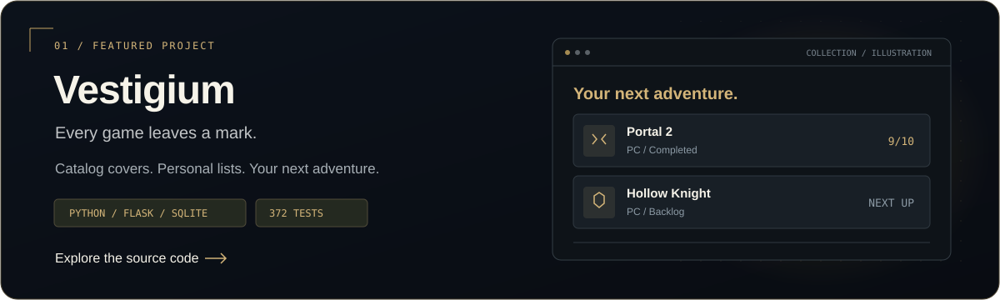

  

  

### A little about me

I'm **Maximiliano**, a Computer Science student at **Pontificia Universidad Católica de Valparaíso**, Chile, studying Ingeniería Civil Informática.

I'm interested in **software development**: understanding a problem, building something useful, and improving it through testing and iteration. Right now, I'm putting those foundations into practice with small, hands-on projects.

**Based in** Santiago / Valparaíso, Chile · **Currently building** Game Backlog

### What I'm building

**[Game Backlog →](https://github.com/PerdonPs3/game-backlog)** is a personal video game tracker with a server-rendered interface and local SQLite storage.

- Create, edit, delete, and filter games by status.
- Add optional ratings and reviews, with server-side validation and CSRF-protected forms.
- Check core behavior with **32 automated test cases**, each using a temporary database.

**Next:** collection search and a game catalog with covers. Steam integration and player progression are longer-term ideas, not current features.

### My toolkit

**Using in Game Backlog**

**Also used through coursework:** Java · C · SQL

### Building, one commit at a time

Generated from my contribution calendar with [snk](https://github.com/Platane/snk).

---

  Small projects. Thoughtful decisions. Steady progress.

