  

    

  

I'm a Computer Science student at **Pontificia Universidad Católica de Valparaíso**, Chile.

I'm interested in **software development** and enjoy understanding how things work, solving problems, and putting what I learn into practice.

### About me

- 🎓 Studying **Ingeniería Civil Informática** at PUCV.
- 💻 Working with **Python, Java, C, and SQL** through academic projects.
- 🌱 Building my foundations and exploring ideas for personal projects.
- 📍 Based in Chile — Santiago / Valparaíso.

### Technologies

  
  
  
  

---

<b>Thanks for stopping by!</b>

